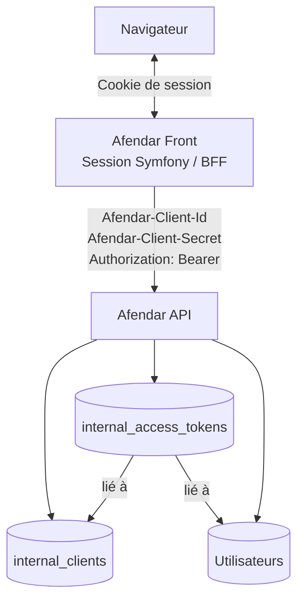
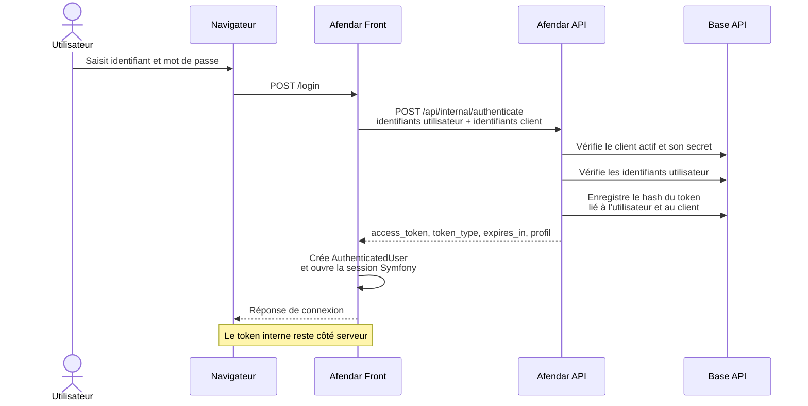
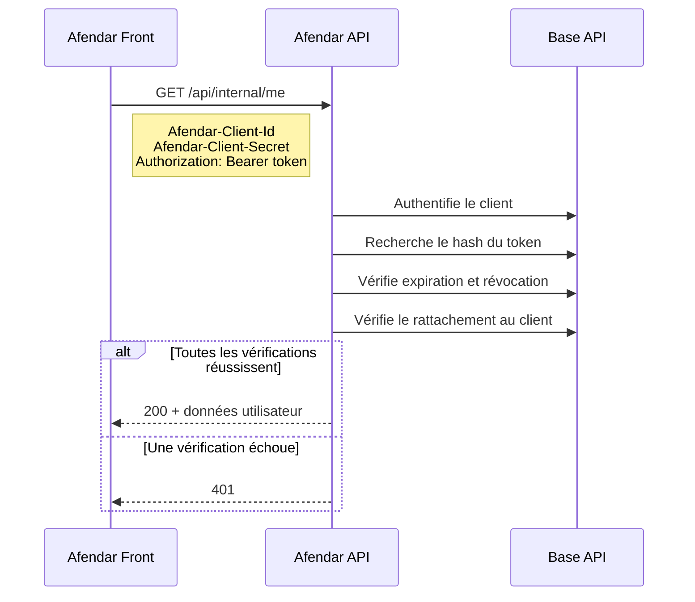

hide:
    - navigation

# Architecture générale

## Composants

- **Navigateur** : communique avec Afendar Front au moyen d'une session Symfony.
- **Afendar Front (BFF)** : authentifie l'utilisateur auprès de l'API et conserve le token interne côté serveur dans l'objet utilisateur de la session Symfony.
- **Afendar API** : authentifie les applications clientes, valide les tokens utilisateur et fournit les données métier.
- **Base de données API** : conserve les clients internes et les tokens sous forme hachée.

## Vue d'ensemble

## Deux contrôles indépendants

Chaque requête interne protégée doit présenter :

1. les identifiants d'une application cliente active ;
2. un token utilisateur valide ;
3. un token rattaché au même client que celui authentifié dans la requête.

La validation du client ne remplace donc pas la validation de l'utilisateur, et inversement.

## Flux de connexion

## Flux d'un appel protégé

## Front comme BFF

Le navigateur ne doit pas recevoir ni stocker le token interne. Il détient uniquement le cookie de session Symfony. Les appels à l'API sont effectués par le serveur Afendar Front, qui ajoute les identifiants client et le Bearer token.
