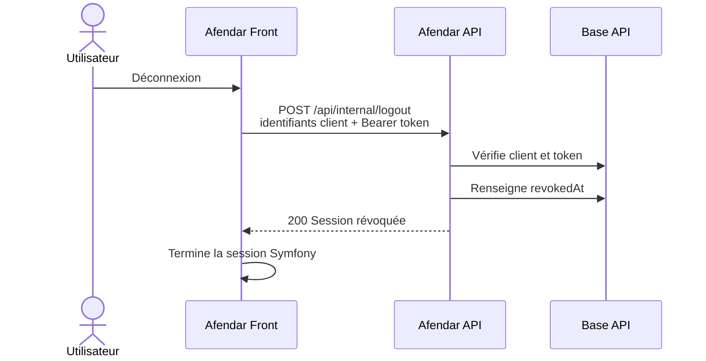

hide:
    - navigation

# Cycle de vie des tokens internes

## Création

À la connexion, `InternalTokenService` génère un secret aléatoire :

```php
$token = bin2hex(random_bytes(32));
$tokenHash = hash('sha256', $token);
```

Le token en clair est retourné une seule fois au front. Seul son hash SHA-256 est enregistré dans `internal_access_tokens`.

Chaque token est associé à :

- un utilisateur (`User`) ;
- un client interne (`InternalClient`) ;
- une date de création ;
- une date d'expiration ;
- éventuellement une date de révocation.

Un token est créé pour une session, et non pour un utilisateur de manière globale. Un même utilisateur peut donc avoir plusieurs sessions simultanées.

## Durée de vie et validation

La durée de vie configurée est de 12 heures. Le repository recherche un token dont le hash correspond, dont la date d'expiration est future et dont `revokedAt` est nul.

La validation vérifie aussi que le client rattaché au token est le même que le client authentifié sur la requête.

## Révocation à la déconnexion

Lors de la déconnexion Symfony, le listener front appelle l'endpoint interne de logout avant la destruction complète du contexte de sécurité. L'API vérifie le client et le token, puis renseigne `revokedAt`.

Le token n'est pas supprimé : son enregistrement est conservé pour l'historique et l'audit.



## Token expiré ou révoqué

Si le front utilise un token expiré, révoqué ou inconnu, l'API répond `401`. `AfendarApi` transforme cette réponse en `AfendarApiException`. Le gestionnaire de session invalide alors la session Symfony locale, puis le subscriber HTTP adapte la réponse au type de requête.

## Plusieurs sessions

La révocation d'un token ne révoque que la session correspondante. Les autres tokens du même utilisateur restent valides tant qu'ils ne sont ni expirés ni révoqués.
